# Azure Hub-and-Spoke Secure Network Architecture (Capstone Project)

## 1. Project Overview
This project implements a production-style, secure **Hub-and-Spoke network topology** in Microsoft Azure. Built through the Azure Portal, this infrastructure isolates backend Linux compute workloads from the public internet while enabling secure administrative access via **Azure Bastion**, strict Layer-4 traffic filtering via **Network Security Groups (NSGs)**, passwordless secret retrieval using **System-Assigned Managed Identities** and **Azure Key Vault RBAC**, and private PaaS storage connectivity using **Azure Private Endpoints** and **Private DNS Zones**.

### Architecture Diagram
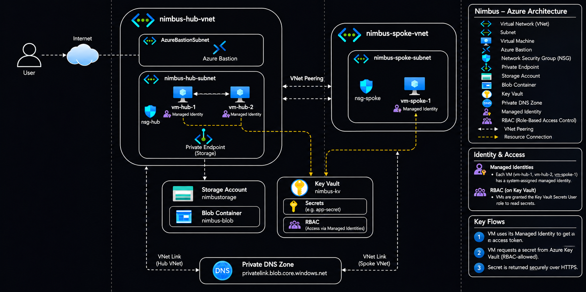

---

## 2. Cloud Service Models & Components Used

| Resource | Service Model | Role in Architecture |
| :--- | :--- | :--- |
| **Virtual Networks (`nimbus-hub-vnet`, `nimbus-spoke-vnet`)** | IaaS (Networking) | Isolated Layer-3 IP address spaces (`10.0.0.0/16` & `10.1.0.0/16`) connected via bidirectional VNet Peering. |
| **Linux Virtual Machines (`vm-hub-1`, `vm-hub-2`, `vm-spoke-1`)** | IaaS (Compute) | Ubuntu Server workloads deployed strictly with private RFC 1918 IP addresses (no Public IPs) and System-Assigned Managed Identities. |
| **Network Security Groups (`nsg-hub`, `nsg-spoke`)** | IaaS (Security) | Stateful Layer-4 packet filters associated at the subnet boundary to enforce least-privilege traffic rules. |
| **Azure Bastion (`nimbus-bastion`)** | PaaS (Security) | Managed jump-host inside `AzureBastionSubnet` providing browser-based SSH over TLS (port 443). |
| **Managed Identities & RBAC** | PaaS / Identity | Passwordless Microsoft Entra ID identities attached to each VM, granted the `Key Vault Secrets User` role. |
| **Azure Key Vault (`nimbus-kv`)** | PaaS (Security) | Centralized hardware-backed vault storing sensitive secrets (`app-secret` / `db-password`) governed by RBAC. |
| **Azure Storage Account (`nimbustorage03`)** | PaaS (Storage) | Blob storage (`nimbus-blob`) locked down to private network access via a Private Endpoint and Private DNS Zone. |

---

## 3. Step-by-Step Implementation

### Phase 1: Networking & VM Deployment

#### Step 1: Create the Hub Virtual Network (`nimbus-hub-vnet`)
* **Objective:** Provision the central Hub VNet (`10.0.0.0/16`) and carve out the primary workload subnet (`nimbus-hub-subnet` - `10.0.1.0/24`) inside the `nimbus-labs` resource group.
* **Why This Matters:** The Hub VNet acts as the central point of connectivity and security inspection. Using a `/16` CIDR block provides 65,536 IP addresses, leaving dedicated address space outside the `/24` workload subnet for shared platform services like `AzureBastionSubnet`.
* **Verification Screenshot:**
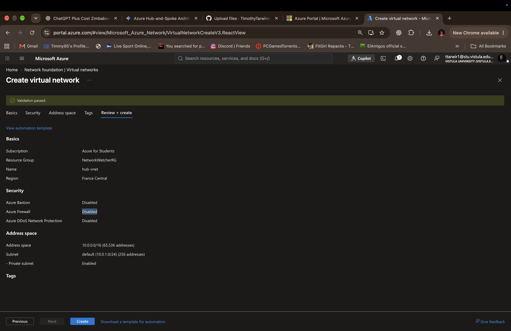

#### Step 2: Create the Spoke Virtual Network (`nimbus-spoke-vnet`) & Configure VNet Peering
* **Objective:** Provision the isolated Spoke VNet (`10.1.0.0/16`) with its workload subnet (`nimbus-spoke-subnet` - `10.1.1.0/24`), and establish bidirectional VNet Peering (`hub-spoke`) between the Hub and Spoke networks.
* **Why This Matters:** Separating workloads into a Spoke VNet enforces network segmentation. Using a non-overlapping `/16` CIDR block (`10.1.0.0/16` vs. `10.0.0.0/16`) prevents routing conflicts and allows seamless Layer-3 private connectivity across Microsoft's backbone via VNet Peering without traversing the public internet.
* **Peering Configuration:**
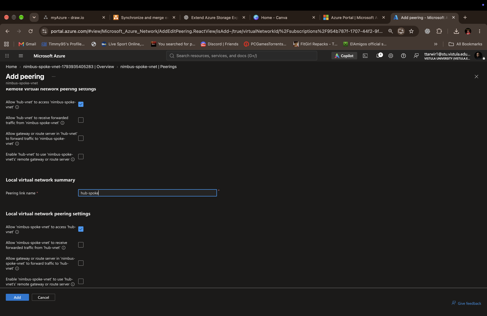
* **Verification (Peering Connected & Fully Synchronized):**
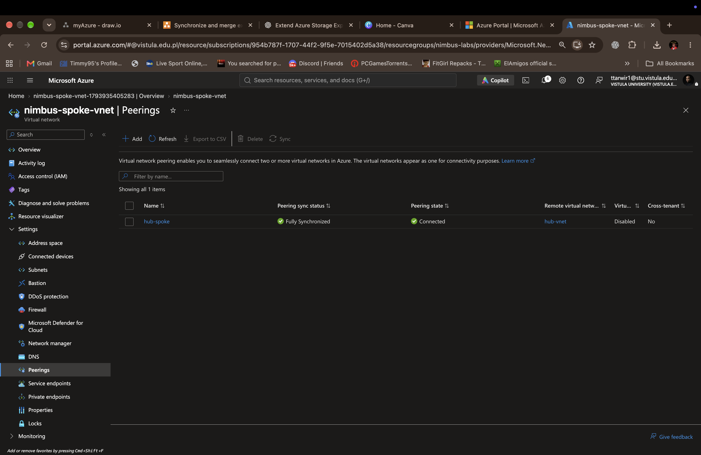

#### Step 3: Deploy Three Linux Virtual Machines (`vm-hub-1`, `vm-hub-2`, `vm-spoke-1`)
* **Objective:** Provision three Ubuntu Server Linux VMs across the Hub and Spoke subnets (`vm-hub-1` and `vm-hub-2` in `nimbus-hub-subnet`; `vm-spoke-1` in `nimbus-spoke-subnet`) with all Public IP addresses disassociated.
* **Why This Matters:** Deploying compute instances without Public IP addresses eliminates direct internet exposure, preventing automated port-scanning and brute-force SSH attacks on port 22. All three VMs rely strictly on private IP allocation and are accessed exclusively through Azure Bastion.
* **Verification Screenshot:**
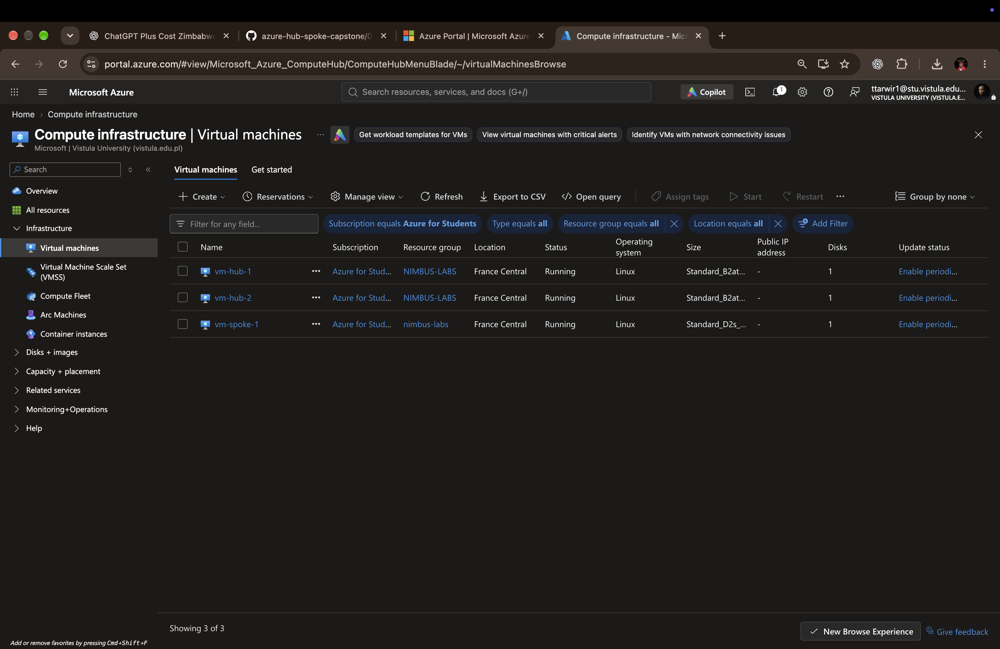

---

### Phase 2: Secure VM Access via Azure Bastion

#### Step 4: Deploy Azure Bastion & Establish Private SSH Sessions
* **Objective:** Provision `nimbus-bastion` inside `AzureBastionSubnet` in `nimbus-hub-vnet` to enable browser-based SSH access to internal VMs without exposing Public IP addresses or port 22 to the internet.
* **Why This Matters:** Azure Bastion acts as a fully managed PaaS jump-host. Administrators authenticate to the Azure Portal over TLS (port 443), and Bastion proxies the SSH connection (port 22) over the private VNet backbone directly to `vm-hub-1` (`10.0.1.4`).
* **Dedicated Bastion Subnet (`AzureBastionSubnet`):**
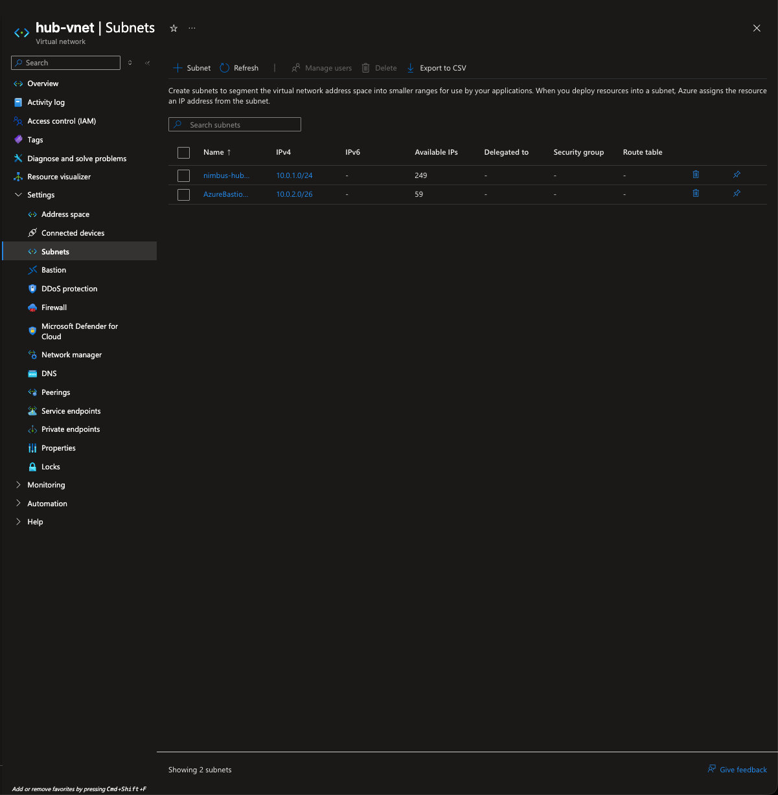
* **Verification (Browser-Based SSH Session into `vm-hub-1` at `10.0.1.4`):**
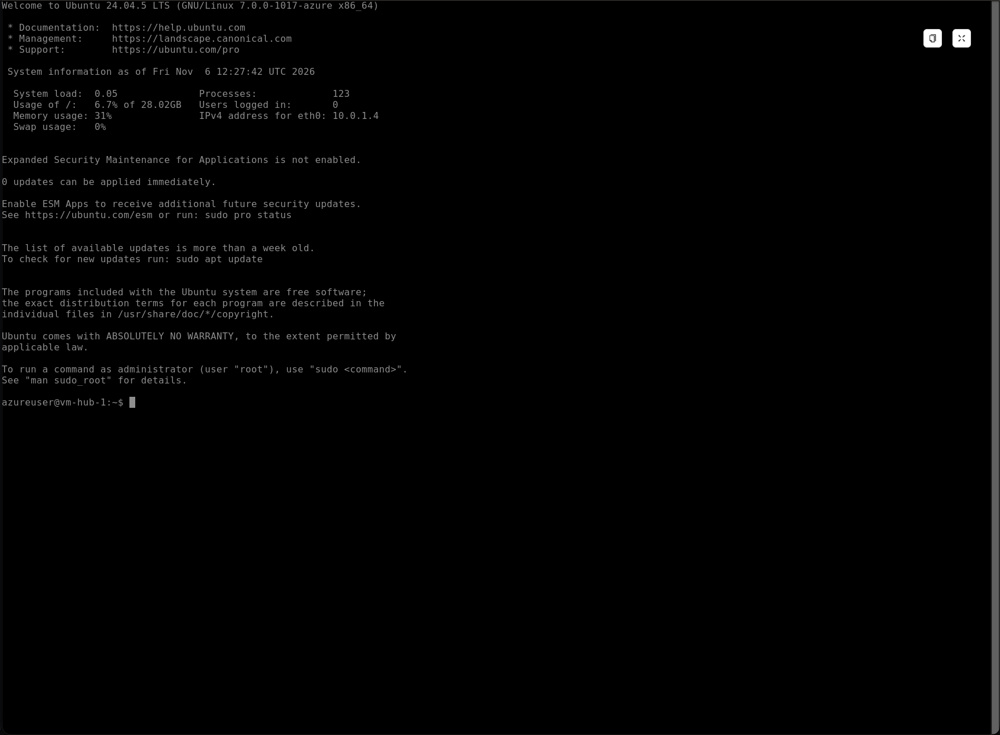

---

### Phase 3: Network Traffic Filtering with NSGs

#### Step 5: Configure & Associate Subnet Network Security Groups (`nsg-hub` & `nsg-spoke`)
* **Objective:** Remove default NIC-level NSGs, provision dedicated Subnet-level NSGs (`nsg-hub-snet` and `nsg-spoke-snet`), configure least-privilege inbound rules for Bastion SSH and internal ICMP diagnostics, and verify connectivity across the VNet peering link.
* **Why This Matters:** Associating NSGs at the subnet boundary enforces uniform Layer-4 stateful packet filtering across all VMs in the subnet. Scoping port 22 strictly to `AzureBastionSubnet` ensures SSH connections are only accepted from the Bastion host, while the `VirtualNetwork` Service Tag permits ICMP echo requests across both `10.0.0.0/16` and the peered `10.1.0.0/16` network.
* **Provisioned Subnet NSGs:**
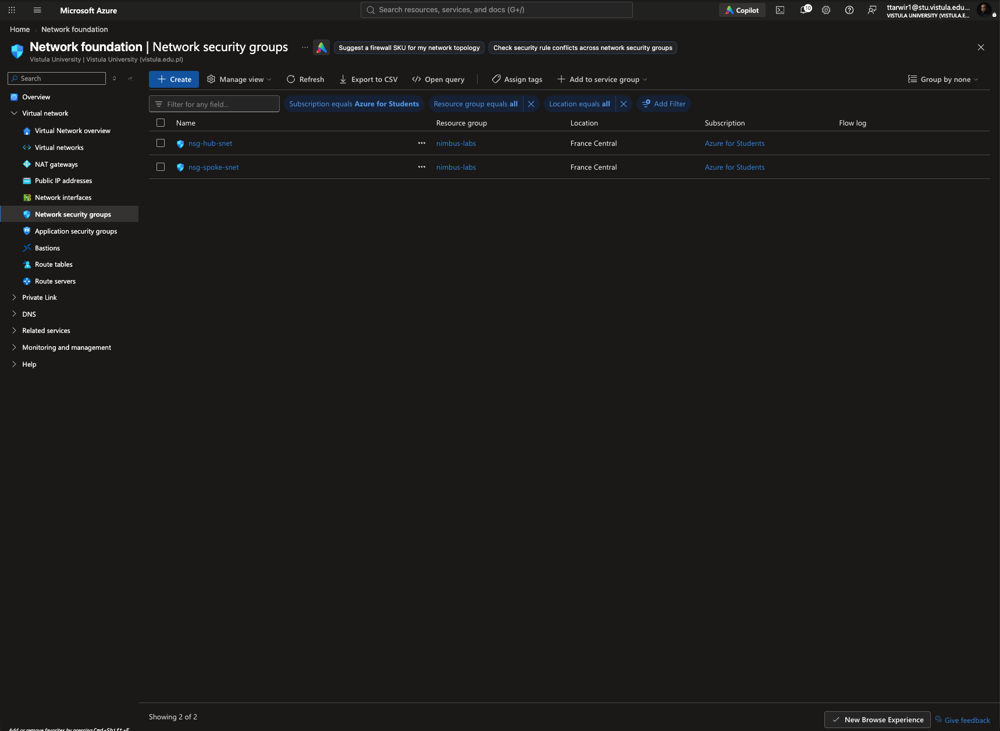
* **Inbound Security Rules (`Allow-Bastion-SSH` & `Allow-vnet-ICMP`):**
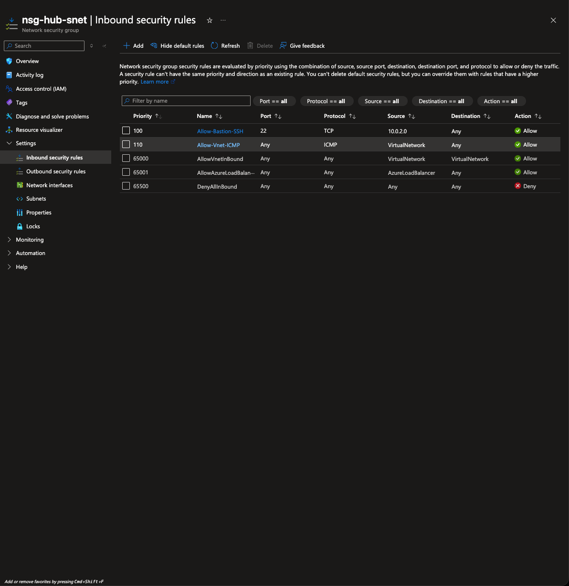
* **Connectivity Verification (Intra-VNet & Cross-VNet Peering Ping Test):**
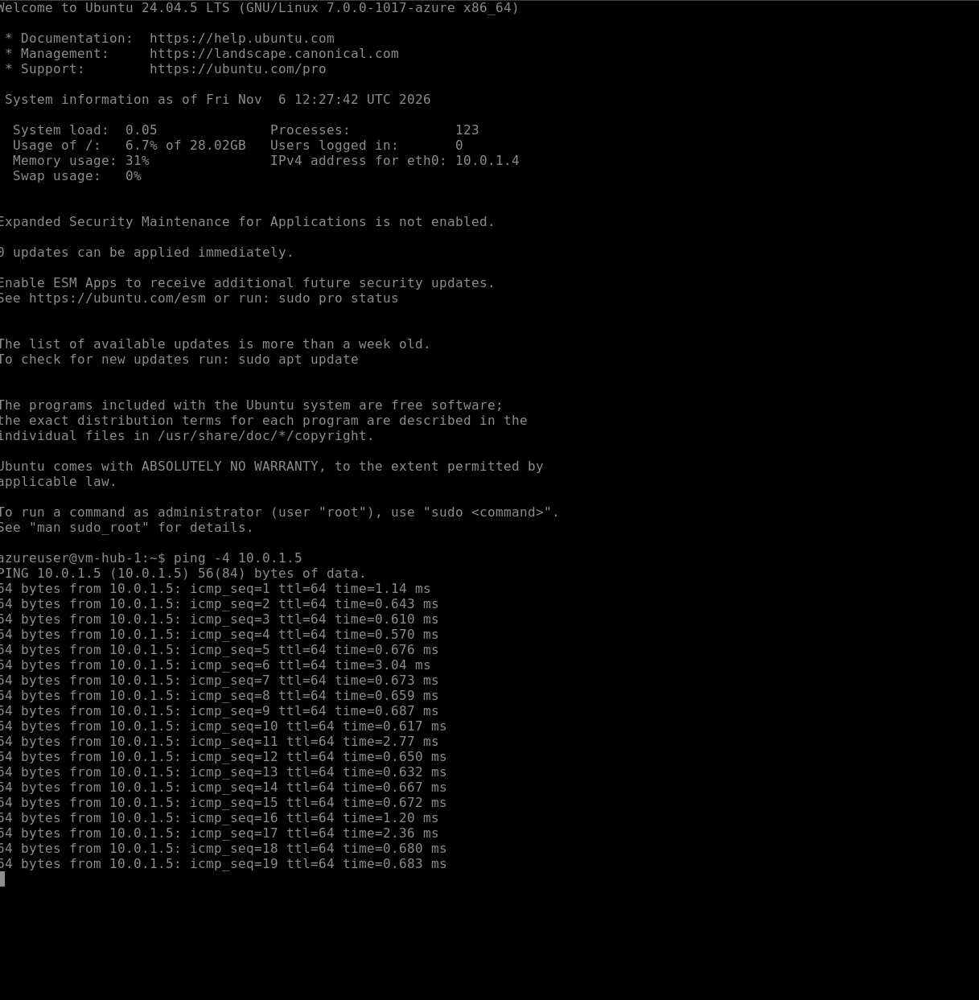

---

### Phase 4: Passwordless Secret Management with Key Vault, Managed Identities & RBAC

#### Step 6: Provision Azure Key Vault, Enable VM Managed Identities, and Configure RBAC
* **Objective:** Deploy Azure Key Vault (`nimbus-kv`) using the Azure Role-Based Access Control (RBAC) permission model, store sensitive application secrets (`db-password` / `app-secret`), and configure **System-Assigned Managed Identities** on all three VMs (`vm-hub-1`, `vm-hub-2`, and `vm-spoke-1`) with the `Key Vault Secrets User` RBAC role.
* **Why This Matters:** Hardcoding database credentials or API keys inside application code or configuration files creates severe security risks. By enabling a **System-Assigned Managed Identity** on each VM and scoping permissions via **Azure RBAC**, VMs can authenticate to Key Vault without ever storing passwords on disk.
* **End-to-End Authentication Flow:**
  1. **Token Request:** The VM uses its System-Assigned Managed Identity to request an OAuth 2.0 access token from the local Azure Instance Metadata Service (IMDS) endpoint (`169.254.169.254`).
  2. **Secret Request:** The VM presents the Bearer token to `nimbus-kv` to request the secret (authorized by the `Key Vault Secrets User` RBAC role).
  3. **Secure Delivery:** Key Vault validates the token against Microsoft Entra ID and returns the secret securely over HTTPS.
* **Verification Screenshot (Secret Stored & Managed in Key Vault):**
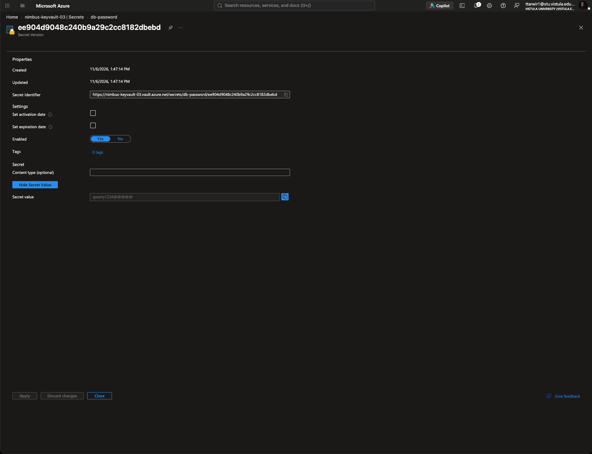

---

### Phase 5: Secure Blob Storage with Private Endpoint & Private DNS

#### Step 7: Provision Storage Account, Private Endpoint, and Private DNS Zones
* **Objective:** Deploy the Storage Account (`nimbustorage`) with public network access restricted, exposing data access internally via a **Private Endpoint** inside `nimbus-hub-subnet` integrated with a **Private DNS Zone** (`privatelink.blob.core.windows.net`) linked to both Hub and Spoke VNets. Create the `nimbus-blob` container and verify file upload (`test.txt`).
* **Why This Matters:** Disabling unrestricted public network access ensures the storage account is protected against internet-based data exfiltration. The Private Endpoint assigns a private IP from `nimbus-hub-subnet` to the storage account, routing storage traffic entirely across Microsoft's private backbone, while the Private DNS Zone links (`VNet Link`) ensure internal workloads in both Hub and Spoke VNets automatically resolve `nimbustorage.blob.core.windows.net` to its private IP.
* **Verification Screenshot (Secure Blob Container & Uploaded File):**
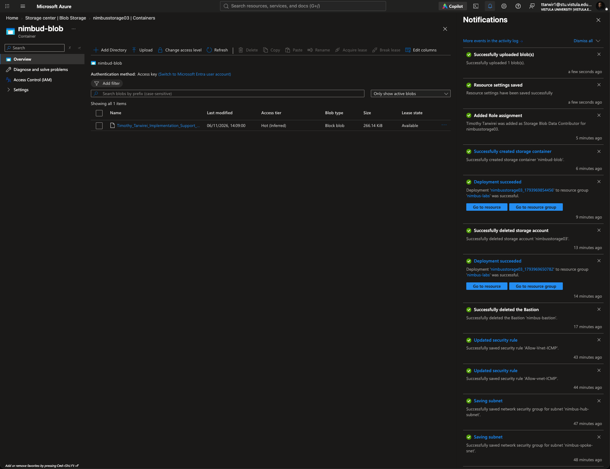

---

## 4. Real-World Troubleshooting & Engineering Lessons Learned

During the deployment of this infrastructure, several real-world cloud engineering challenges were encountered and resolved:

1. **Default Public IP Attachment & Regional Quota Exhaustion (`3 of 3` Limit):**
   * **Issue:** During initial VM provisioning, Azure attached default Public IP resources to the VM NICs. When attempting to provision Azure Bastion, deployment failed due to hitting the regional Public IP quota limit (`3 of 3` on the Azure for Students subscription).
   * **Resolution:** Disassociated the Public IPs directly from each VM's NIC (`ipconfig1`) and deleted the orphaned Public IP objects from the `nimbus-labs` resource group, freeing up regional quota for the Bastion gateway and enforcing strict private-only VM access.
2. **Consolidating NIC-Level vs. Subnet-Level NSGs:**
   * **Issue:** Default VM creation generated individual NIC-level NSGs (`vm-hub-1-nsg`, etc.), creating redundant management overhead alongside our planned subnet-level NSGs.
   * **Resolution:** Disassociated and removed the default NIC-level NSGs, standardizing traffic filtering at the subnet boundary (`nsg-hub-snet` and `nsg-spoke-snet`) using the `VirtualNetwork` Service Tag for cross-peering ICMP diagnostics.
3. **Storage Account Data-Plane RBAC & Private Network Enforcement (`HTTP 403 Forbidden`):**
   * **Issue:** Attempting to view and upload blobs into the `nimbus-blob` container via the Azure Portal initially returned a `403 This request is not authorized to perform this operation` error, even as the Subscription Owner.
   * **Resolution:** Identified two distinct security boundaries at play: (1) Control Plane ownership does not automatically grant Data Plane blob access, requiring explicit assignment of the **Storage Blob Data Contributor** RBAC role, and (2) setting the Storage Account to *Private endpoint only* blocks the Azure Portal browser client over the public internet, requiring either internal VNet access or temporary client IP whitelisting under the Storage Account firewall for administrative portal uploads.

---

## 5. Security Architecture Summary
By combining **network segmentation (Hub-and-Spoke VNets)**, **perimeter hardening (zero VM Public IPs + Azure Bastion)**, **micro-segmentation (Subnet NSGs)**, **passwordless identity governance (System-Assigned Managed Identities + Entra ID RBAC for Key Vault and Blob Storage)**, and **private PaaS injection (Private Endpoints + Private DNS)**, this architecture implements a defense-in-depth cloud posture ready for enterprise workloads.
